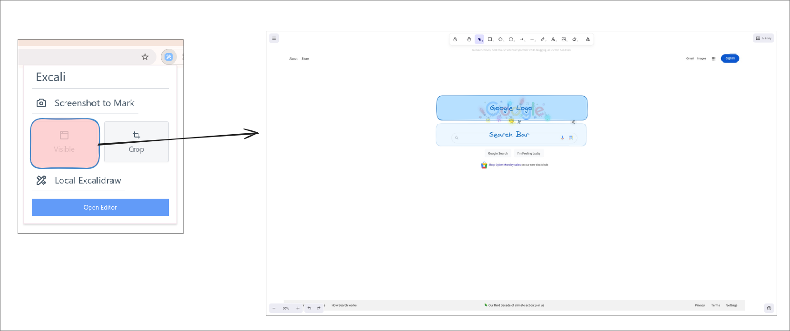
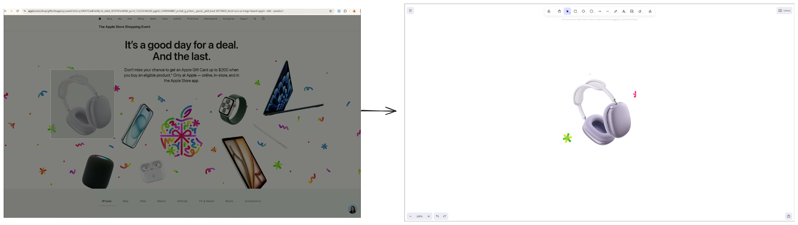
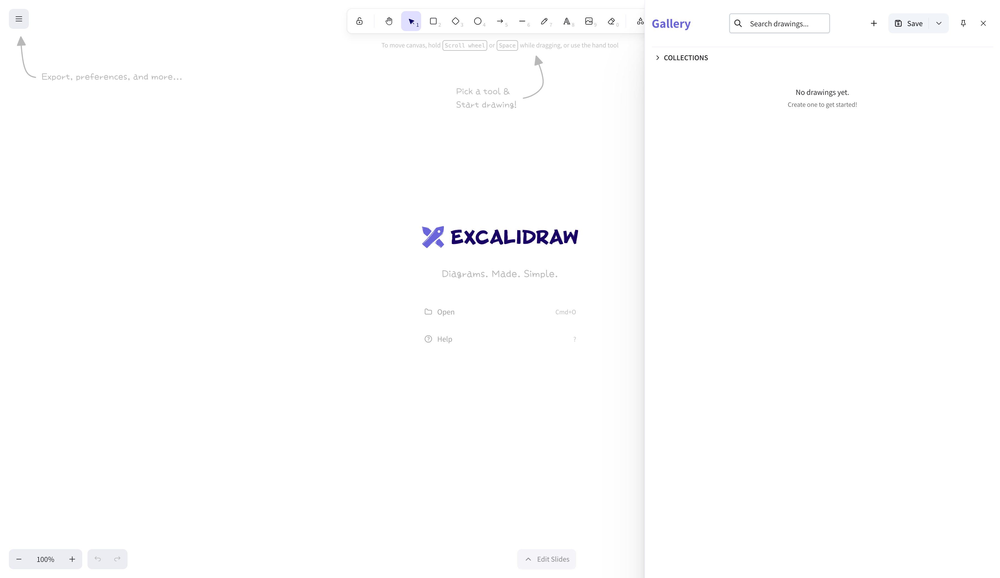
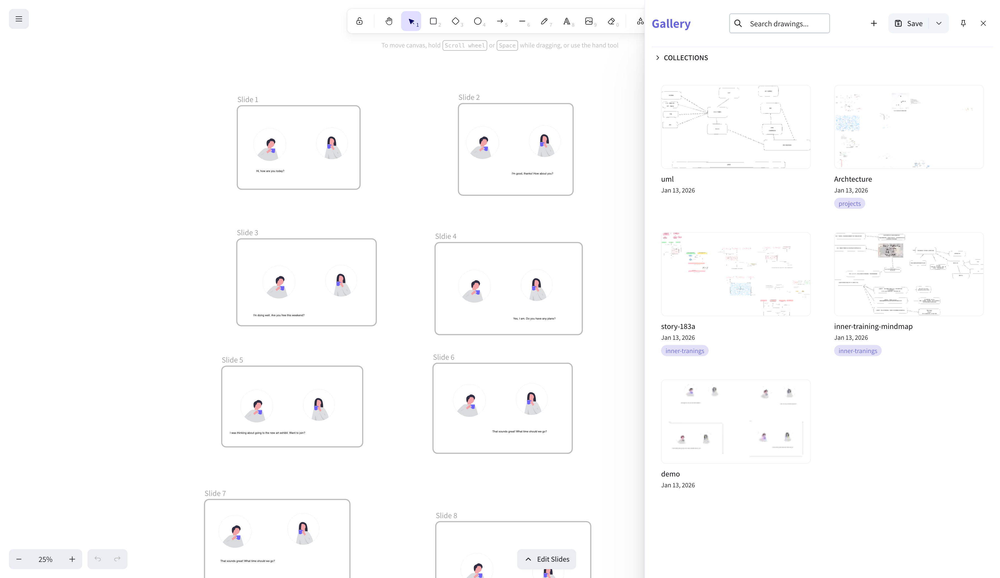
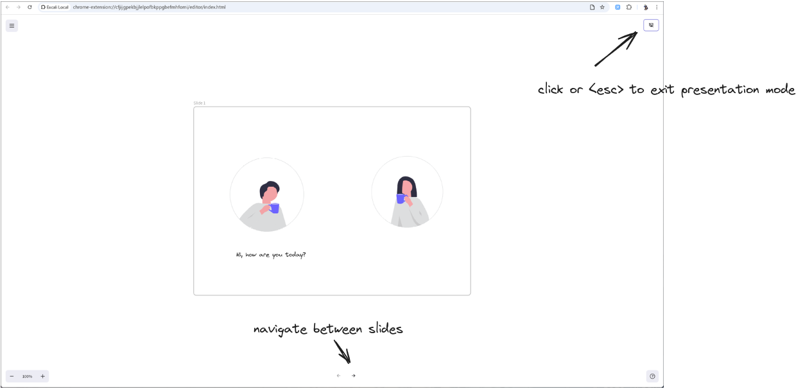
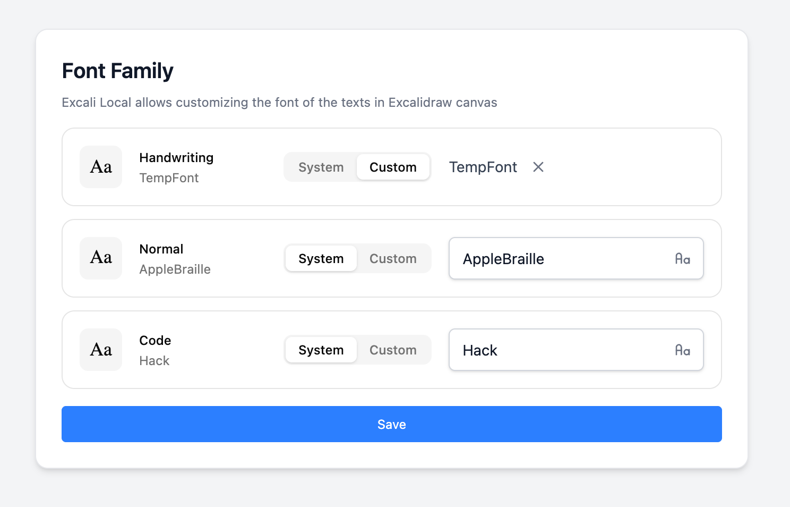

# Excali Local

[English](./README.md)

> 一款本地优先、完全离线的 Excalidraw 应用，整个运行在你的浏览器里。

<p align="center">
  
</p>

Excali Local 是一个浏览器扩展，让 **Excalidraw 完全离线可用**：截图标注、完整的本地编辑器、私有图库和演示模式——没有后端、没有账号、没有上传。每张绘图都留在你的浏览器里。

## v1.9.0 新特性（未发布）

- **跨机画布传输（Peering）** — 把画布交给同一局域网内的另一台机器：接收方右上角弹出带倒计时的浮层，点接受，画布即落地——无需文件、无需房间、无需中继。按设计采用手工地址交换（无发现、无 mDNS）；传输为明文，由接收方确认。→ [Peering](docs/PEERING.md) · [测试指南](docs/PEERING-TESTING.md) · [ADR 0013](docs/adr/0013-cross-machine-canvas-transfer.md)

## v1.8.0 新特性

- **实时协作** — 无宿主、端到端加密的房间，跑在你自行部署的中继之上（约 150 行的 partyserver 参考实现，Cloudflare Workers；没有 Excali Local 后端——中继只转发密文）。团队房间对组织端到端加密，私有房间按房间端到端加密；包含文件同步。→ [协作指南](docs/COLLAB.zh-CN.md) · [ADR 0003](docs/adr/0003-byo-relay-realtime-collab.md)

## v1.7.0 新特性

- **从 ZIP 导入图库** — 把之前导出的压缩包（即使在应用之外编辑过）重新导入图库。
- **智能体驱动编辑** — 通过 `excali-local` 技能和 `excali-bridge` 守护进程，经仅限本地的 WebSocket，从 CLI 或 AI 智能体驱动当前画布。→ [Agent Bridge 指南](docs/AGENT_BRIDGE.zh-CN.md)

> 快速上手（约 1 分钟、无声、双语字幕）：
>
> [](https://youtu.be/0ceYcxnoB9M)

## 功能

- **截图标注** — 截取整页或框选区域，然后在 Excalidraw 中标注。
- **离线编辑器** — 完整的 Excalidraw 体验，无需联网。
- **图库与集合** — 在本地保存、整理、搜索和管理绘图；可将绘图与集合导出或导入为 ZIP 压缩包。
- **演示模式** — 把任何绘图变成基于幻灯片的演示。
- **自定义字体** — 上传 `.ttf`、`.woff` 或 `.woff2` 字体，或使用系统字体；编辑器基于完全离线的 Excalidraw 0.18 分支构建。
- **直接打开 `.excalidraw` 文件** — 从任意网站或本地文件夹在编辑器中打开文件。
- **快捷键与深色模式** — 处处快速访问，夜间护眼。

## 安装

- [Chrome 网上应用店](https://chromewebstore.google.com/detail/excali-local/ebmgbhnihcbgpbcjnjeamnkkplnppddd)
- [Firefox 附加组件](https://addons.mozilla.org/addon/excali-local)
- [Edge 加载项](https://microsoftedge.microsoft.com/addons/detail/excali-local/kflccadkimelkkjcmedhhfbnnlbdggol)

演示：[YouTube](https://youtu.be/_aHWUz9Og-I) | [哔哩哔哩](https://www.bilibili.com/video/BV1gJqnY3EAP)

## 工作原理

1. **截图并标注** — 截取整页或框选区域，直接在 Excalidraw 中标注。

| 整页截图 | 框选区域 |
|:-:|:-:|
|  |  |

2. **本地编辑与整理** — 每张绘图都存在浏览器里（IndexedDB）。把绘图归入集合、搜索它们，并将绘图与集合导出或导入为 ZIP 压缩包。

| 空图库侧栏 | 带绘图的图库 |
|:-:|:-:|
|  |  |

3. **演示** — 用简单的导航把绘图变成幻灯片演示。



4. **个性化** — 上传自己的字体，或使用系统字体系列（`.ttf`、`.woff`、`.woff2`）。



5. **打开 `.excalidraw` 文件** — 被识别的文件会得到"用 Excali Local 打开"按钮，一键导入。

<video src="https://github.com/user-attachments/assets/3be7b273-cac4-4fc8-ab03-5bb50eab8cd4" autoplay loop muted></video>

6. **从智能体或 CLI 驱动画布** — 在扩展中开启智能体访问，安装技能（`npx skills add azzgo/excali-local --skill excali-local -y`），然后通过本地 WebSocket 桥接以编程方式绘图。完整指南：[Agent Bridge 指南](docs/AGENT_BRIDGE.zh-CN.md)。

## 用 workerd 自托管中继（不需要 Cloudflare 账号）

协作需要一个中继。**默认方式是 Cloudflare Workers** —— 在你自己的 Cloudflare 账号上
执行一次 `wrangler deploy`（见[协作指南](docs/COLLAB.md)）。如果你完全不想用
Cloudflare，可以用 `workerd`（Cloudflare 边缘跑的那个开源运行时）把**同一个中继**跑在
你自己的机器上。不需要账号，不经过第三方；进程监听在你本机，房间状态存在本地 SQLite 里。

一条命令搞定：

```bash
pnpm install
pnpm relay:serve --url https://relay.example.com
```

它会打印一个 `ORG_PUBKEYS` 值（同时写入中继读取的环境变量），以及一份可直接粘贴的
**服务器邀请**（Options → Collaboration）。把这个 URL 放到 Caddy 或 nginx 后面提供 TLS。
成员粘贴邀请即可照常协作。

```bash
pnpm relay:serve                                  # 127.0.0.1:1999，本地测试
pnpm relay:serve --port 8080 --url https://relay.example.com
pnpm relay:serve --help                           # 查看全部参数
```

| 参数 | 默认值 | 含义 |
| --- | --- | --- |
| `--port` | `1999` | 监听端口 |
| `--host` | `127.0.0.1` | 监听地址（用 `0.0.0.0` 接受远程流量） |
| `--url` | `http://127.0.0.1:<port>` | 成员实际拨号的**公网** URL |
| `--org` | `local` | 组织标签 |
| `--keys` | `.selfhost-keys.json` | 组织身份文件（已加入 gitignore） |

### 真实部署必须有 TLS

客户端只对回环地址（`127.0.0.1` / `[::1]`）接受明文 `http://`\/`ws://`。任何其他机器能访问的
地址都必须是 `https://`。`relay:serve` 自身不处理 TLS —— 请在它前面挂一层，例如：

```caddyfile
relay.example.com {
  reverse_proxy 127.0.0.1:1999
}
```

```bash
pnpm relay:serve --host 127.0.0.1 --port 1999 --url https://relay.example.com
```

### 需要知道的几件事

- **密钥就是组织。** `.selfhost-keys.json` 保存签名种子与内容密钥；持有邀请的人就是成员。
  请备份、切勿提交（已在 gitignore 中），若泄露则按[密钥轮换](docs/COLLAB.md)处理。
  如果你想要一次性生成的、不落盘的生产密钥，改用
  `pnpm relay:keygen --org acme --relay https://relay.example.com`，并自行设置
  `ORG_PUBKEYS`。
- **仅单节点，无 SLA。** 房间状态是单机上的本地 SQLite —— 没有复制，也没有第二个节点。
  可用性、备份、TLS 与升级都由你自己负责。
- **先验证运行时再信任它。** 中继的准入基于 Ed25519，而并非所有 Workers 运行时都实现它：
  `workerd` 实现了，但例如 `celld` 没有。`pnpm relay:smoke` 会证明当前运行时能正确导入并
  验证 Ed25519 原始密钥 —— 更换运行时版本后请跑一次。

背景与被淘汰的备选方案：[ADR 0010](docs/adr/0010-self-host-cf-workerd.md)。

## 参见

构建智能体驱动功能时参考过的实现：

- [smart-excalidraw-next](https://github.com/liujuntao123/smart-excalidraw-next) — 一个支持智能体驱动画布控制的 Next.js Excalidraw 应用。
- [excalidraw-diagram-skill](https://github.com/coleam00/excalidraw-diagram-skill) — 一个用于绘制 Excalidraw 图表的智能体技能。

## 开发

基于 pnpm 的 monorepo。

```bash
pnpm install        # 安装依赖
pnpm page:dev       # 启动编辑器 webapp
pnpm page:build     # 构建编辑器 webapp
pnpm local:build    # 构建扩展（然后以解压方式加载 .output/chrome-mv3）
pnpm local:tar      # 归档构建产物
```

包列表：`local`（扩展外壳）、`page`（编辑器应用）、`shared`（字体库 + 通信契约）、
`bridge`（Go 守护进程 + 智能体 CLI）、`presence`（Rust 菜单栏托盘，通过 exec
`excali-bridge` 驱动守护进程），以及 `collab-core` / `collab-relay`（协作）。`bridge`
与 `presence` 不走 pnpm 构建：

```bash
pnpm bridge:build   # 构建守护进程（go build）
cd packages/presence && cargo build --release   # 构建托盘
```

### 发布资产（守护进程 + 托盘）

`pnpm skill:pack` 会交叉编译 Go 守护进程的四个 target，把二进制与 `checksums.txt`
暂存到仓库之外（ADR 0012）；随后它会调用 `pnpm presence:pack`，按 ADR 0014 的矩阵构建
Rust 托盘 —— `excali-presence-macos-aarch64`、`excali-presence-macos-x86_64`、
`excali-presence-linux-x86_64` —— 放进同一个暂存目录、同一个 `checksums.txt`。
本机无法交叉构建的托盘 target 会打印 `WARN` 后跳过（请在它的原生 runner 上构建；
发布 workflow 每个 target 一个 job）。`pnpm presence:pack --target <triple> --strict`
只构建单个 target，且无法构建时直接失败而不是跳过。

Windows 目前是占位：`excali-presence-windows` 尚不存在 —— **欢迎 PR**
（维护者没有 Windows 机器）。

---

*截图来自 [unDraw](https://undraw.co/) — 面向所有人的免费插图。*
