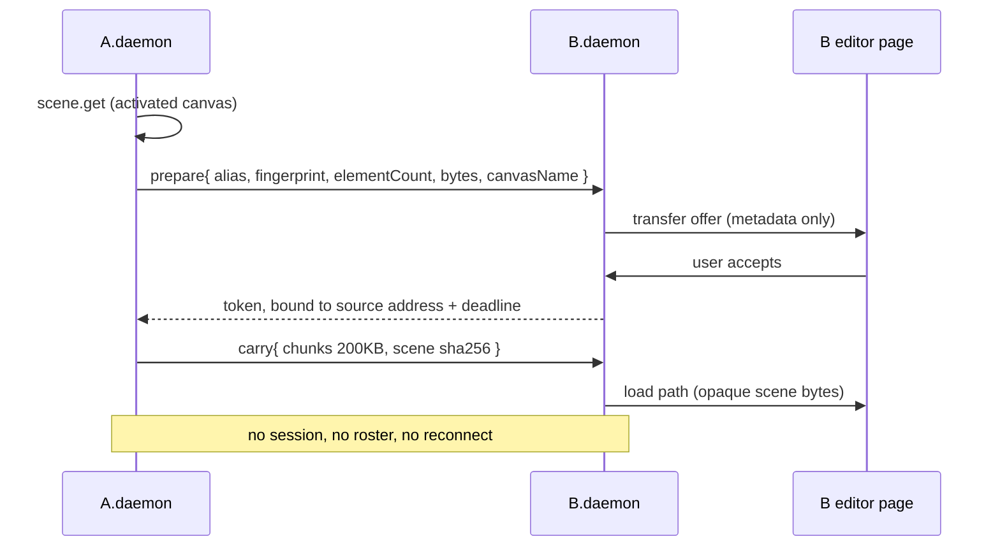

# Peering — cross-machine Canvas transfer

> Developer doc. Design decisions: [ADR 0012](adr/0012-bridge-daemon-is-the-product-presence-is-its-face.md)
> (daemon as subject, Presence as face) and
> [ADR 0013](adr/0013-cross-machine-canvas-transfer.md) (transfer shape, trust, limits).
> Vocabulary: [`CONTEXT.md`](../CONTEXT.md) → *Peering*.

Peering is the first thing the Bridge daemon does that another machine can see. It
exists to carry **one canvas from machine A to machine B** on the same network,
with no file, no room, and no relay involved.

## Surfaces

The daemon has exactly two listening surfaces. They are different surfaces, not
one surface with two settings.

```text
loopback surface              LAN listener
  127.0.0.1:17331..17335        0.0.0.0:ephemeral
  always on                     off by default, off again after restart
  paired connection +           Canvas transfer only
    activated canvas gates      no scene read/write, no gallery, no fonts
  origin allow-list             no origin allow-list (peers send no Origin)
    chrome-extension://…          peer identity is a manually exchanged address
```

Adding a Peering method to the loopback surface is a mistake: an agent driving a
canvas and a stranger's machine offering a canvas must never share a capability
set.

## State and switch

```text
~/.local/bin/excali-bridge-<os>-<arch>   real binary (canonical, one per machine)
~/.local/bin/excali-bridge              symlink → the above
XDG_CONFIG_HOME/excali-local/config.json   { lan: on|off, alias, fingerprint }
XDG_STATE_HOME/excali-local/bridge.pid, bridge.log

%LOCALAPPDATA%\ExcaliLocal\bin\          Windows binaries
%LOCALAPPDATA%\excali-local\             Windows state/config
```

`excali-bridge lan on|off|status` is the single source of truth. The tray menu and
the extension's Options page act through it; neither keeps its own copy, and
neither writes a second login item. `EXCALI_BRIDGE_BIN` overrides the binary
candidates for development only — there is no silent fallback to a second copy.

> Shipping status: the switch, the CLI and the extension's Options surface are
> implemented; the tray (Presence host) is designed (ADR 0012) but not built,
> and `autostart` detects the login item without writing one. `lan on` persists
> the switch only — a running daemon must be restarted before the listener
> opens, because runtime start/stop would fight the Shutdown lifecycle.

## The exchange

S1 — sender pushes, receiver accepts, receiver's canvas is replaced.



The offer carries **descriptions only** — device alias, device fingerprint,
element count, estimated bytes, the canvas's local name. No elements and no
thumbnail: a thumbnail is content, and rendering one would require reading the
canvas before acceptance.

The daemon never parses the scene. It moves opaque bytes from `scene.get` to the
load path, so it holds no Excalidraw schema dependency and does not track
Excalidraw versions.

## Acceptance

The offer surfaces on B's extension page as a toast in the top-right — never a
modal, never a banner that reflows the editor — with a countdown reading
`expiresAt` from the protocol. The page answers through
`peers.transferRespond`; the daemon's pageDecider never decides on the user's
behalf, and a late answer for an expired or already-answered offer is refused.
The daemon keeps offer metadata **in memory, with a deadline**, and stores no
canvas content before acceptance; with no page present the transfer expires
rather than accumulating an unowned content cache behind an open LAN port. A
tray notification is a convenience, never the only path — the tray must stay
non-load-bearing.

## Numbers

| Quantity | Value | Why this one |
| --- | --- | --- |
| chunk size | 200KB | same constant as `collab-core/src/chunk.ts`; the loopback WS default frame cap is 1MB, and the page/agent connections are raised to 256MB because a scene read is not control traffic |
| scene cap | 64MB | an in-memory move; a canvas with embedded images realistically exceeds 20MB |
| integrity | whole-scene sha256 | per-chunk verification adds cost without adding anything on a plaintext wire |
| offer TTL | 60s, in-memory | long enough to notice a prompt, short enough that nothing idles on a LAN-open port |

The relay's 20MB per-file cap is **not** unified with the 64MB transfer cap: one
is durable-object storage, the other is an in-memory move. Two cost models, two
numbers.

## Failure paths

```text
peer not announcing       → not in the list; manual address fallback
offer, no page connected  → expires; sender sees a timeout, not a rejection
receiver declines         → reject; sender's canvas untouched
sender loses the canvas   → transfer aborts; receiver keeps its own canvas
token wrong / replayed    → refused (token + source address + deadline)
daemon too old            → handshake version negotiation fails loudly;
                            never silently interpreted as "declined"
scene over 64MB           → refused before any bytes are sent
sha256 mismatch           → receiver discards the staged scene, keeps its canvas
```

## What this is not

- **Not a room.** No relay, no roster, no shareId, no persistence. Rooms are
  ADR 0003 and are unchanged.
- **Not Canvas handoff.** Handoff is local and seeds a room; a transfer crosses
  machines and seeds a canvas.
- **Not synchronization.** One move, one direction, one acceptance. Bidirectional
  merge would drag `merge.ts` semantics into the daemon and is rejected.
- **Not encrypted.** Same-network parties can observe and forge. See
  [KNOWN_LIMITATIONS.md](KNOWN_LIMITATIONS.md) → *Peering*. A future mitigation is
  anonymous and offer-scoped; a PKI/TOFU/revocation story is not in scope (same
  reasoning that rejected the mini-CA in ADR 0003).

## Discovery

There is none, on any platform, by decision (ADR 0013 decision 3 as amended in
review; see KNOWN_LIMITATIONS → "no automatic discovery"). The LAN port is a
system-assigned ephemeral that changes on every daemon restart, so the address
is exchanged by hand — a copy-paste of the receiver's `IP:lanPort`, read from
its `/health` or `lan.status`. `excali-bridge peers` lists the peers the user
added this way and stays the GUI-free view; the tray, when it exists, is never
the only way to see or act on them.

## Migration notes (one release cycle)

- `~/.excali-local/bridge.pid` and `bridge.log` move to the platform state
  directory. `pidfile` and the CLI's lazy-spawn path must read the old location
  once, or users silently start a second daemon.
- Binaries leave git. `pnpm skill:pack` keeps its cross-compile and static-verify
  gates but writes outside the repo; `skill:check` gains a guard that no
  executable reappears under `skills/excali-local/bin/`.
- A fresh clone can no longer `ping` without downloading a binary. Accepted cost.
